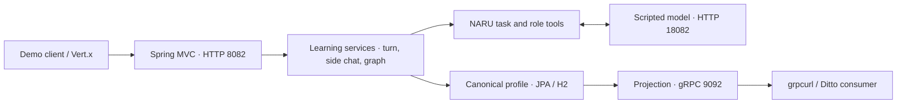

# NaruProf NARU presentation guide

## What to say in the opening minute

“NaruProf NARU is the learning engine behind the application. It accepts a learner action, checks that it targets the current turn, and saves the accepted input. A real NARU task handles the model and tool calls. The engine saves the resulting transcript and emits a stream for the client. A separate gRPC reader gives Ditto a versioned summary of the committed learning records.”

The demo calls the engine's private listeners directly. In the integrated application, Vert.x relays the HTTP requests and Ditto consumes the gRPC projection. The Python fixture supplies deterministic model responses. The Java engine still admits turns, runs NARU tasks, dispatches tools, settles sessions, and merges graph changes.



Keep the **lesson plan** and the **knowledge graph** visible at different points. The plan belongs to one teaching session and its question points to a plan node. The graph stores propositions and reasoning chains from sources. gRPC projects counts from the profile.

## What each component owns

| Component | Responsibility | Evidence in the demo |
| --- | --- | --- |
| Servlet controller | Authenticated HTTP and media types, then delegation | JSON admission, SSE turns, NDJSON replies, multipart import and ZIP export |
| Learning services | Turn rules, role selection, graph merge and saved IDs | A stale occurrence fails, a valid answer references the original tool call and a repeat import preserves canonical identity |
| NARU adapter | One task and its allowed tool registry for each inference step | The scripted provider requests `probe`, `probe_done`, `plan_init` and `quiz`. The Java service applies each result |
| Profile store | Canonical messages, graph and profile settings | Closing a client leaves the record intact. A live restart chapter exercises the same profile on disk |
| Projection adapter | Authenticated snapshot and replay from committed revisions | `GetSnapshot` fetches the head. `Watch` resumes after the supplied cursor |

A client can attach after submitting input because admission and turn execution have separate lifetimes. Side chats have their own request and NDJSON stream. The helper gets a filtered lesson context with open answer keys withheld. The scripted model does not exercise real-provider quality or billing.

## Rehearse the live setup

Use JDK 25 and Maven with the dependencies cached or access to Maven Central. Check that both `java -version` and `mvn -v` report Java 25. The demo client and provider use Python 3's standard library. `jq` is convenient for manual calls. `grpcurl` is optional for the gRPC chapter. Use the right protoc classifier for your platform. [Build and platform details](README.md)

Run all commands from `naruprof-naru/`. The examples use Bash.

**Build before the presentation**

```bash
mvn -DskipTests package
test -f app/target/app-1.0.0.jar
```

**Terminal 1 — the deterministic provider**

```bash
python3 fixtures/model.py --slow-seconds 8
```

**Terminal 2 — the engine and its dedicated profile**

```bash
export NARUPROF_DATA_DIR="$(mktemp -d)"
export LH_AUTH_FILE="$NARUPROF_DATA_DIR/auth.json"
export LH_IGNORE_ENV_KEYS=1
export NARUPROF_PROFILE_ID=f7933216-20db-49cb-90e0-3a9d5396966d
export NARUPROF_MODEL_URL=http://127.0.0.1:18082/v1/chat/completions
export NARUPROF_MODEL_ID=fixture
export VERTX_TO_NARU_TOKEN=fixture-vertx
export TWIN_TO_NARU_TOKEN=fixture-twin
printf 'Keep this directory for the restart chapter: %s\n' "$NARUPROF_DATA_DIR"
java -jar app/target/app-1.0.0.jar
```

**Terminal 3 — the client**

```bash
export NARU_HTTP_URL=http://127.0.0.1:8082
export NARU_GRPC_TARGET=127.0.0.1:9092
export NARUPROF_PROFILE_ID=f7933216-20db-49cb-90e0-3a9d5396966d
export VERTX_TO_NARU_TOKEN=fixture-vertx
export TWIN_TO_NARU_TOKEN=fixture-twin

python3 fixtures/demo.py --pause
# Include snapshots if grpcurl is installed
python3 fixtures/demo.py --pause --grpc
# On a fresh profile, include the additional route and timing checks
python3 fixtures/demo.py --pause --grpc --extras
```

Choose one client command per rehearsal. Use a new profile for exact revision numbers or for `--extras`. The extra chapter changes settings and deletes objects created by the demonstration. Keep the teaching chat ID printed at the end to demonstrate persistence.

## Suggested presentation order

| Time | What to show | What it proves |
| --- | --- | --- |
| 0–2 min | Show the diagram, then a `401` without a bearer credential and `200` on readiness with it | The HTTP listener is a private service boundary |
| 2–5 min | Create “Fractions demo,” submit a question, follow SSE, and reopen the probe | Input admission is separate from model execution and record retrieval |
| 5–7 min | Submit a stale occurrence and get `400`. Submit the saved occurrence and show `toolResult.toolCallId`, the plan and the question tagged `scale` | Reopened state contains stable IDs. An accepted probe answer can advance to planning and teaching |
| 7–9 min | Create a practice session, submit reasoning for the problem, and submit `next` | Practice keeps independent state and a new problem gets its own call ID |
| 9–11 min | Import the notes and inspect the chain, source provenance, and projection | The graph merge persists before its summary becomes visible |
| 11–13 min | Ask for a side hint and show the opening and final NDJSON events. Reopen the thread and show Markdown or ZIP export | Side replies have a separate stream and durable record |
| Optional | Stop the engine, restart it on the same profile, and fetch the same chat ID again. Replay gRPC from revision 1 | Native history and projection revisions survive process restart |

For a five-minute slot, show the teaching flow, then the graph import and gRPC snapshot. Use the route inventory as an appendix during questions.

## Manual calls for screen sharing

Set the variables from Terminal 3 above. These requests assume the matching profile and fixture are running.

```bash
api() {
  curl -sS --fail-with-body -H "Authorization: Bearer $VERTX_TO_NARU_TOKEN" "$@"
}

curl -i "$NARU_HTTP_URL/internal/health/live"
api "$NARU_HTTP_URL/internal/health/ready"

CHAT=$(api -H 'Content-Type: application/json' -d '{"title":"Fractions"}' \
  "$NARU_HTTP_URL/api/chats" | jq -r .id)
jq -nc --arg chat "$CHAT" '{chatId:$chat,input:{type:"text",text:"Why halves?"}}' |
  api -H 'Content-Type: application/json' -d @- "$NARU_HTTP_URL/api/chat"
api -N "$NARU_HTTP_URL/api/chats/$CHAT/stream"

api "$NARU_HTTP_URL/api/chats/$CHAT" | jq '.messages[-1]'
```

The submission normally responds with `{"ok":true}`. Follow the turn stream to `data: [DONE]`. If inference already finished, the stream can return an idle `turn-settled` immediately. Fetch the canonical chat in either case. A turn stream carries `message_update` and `message_end` frames when those are available.

Use the saved message ID, tool call ID, content index and tool name from the probe. In the normal initial fixture response the probe is the only content block.

```bash
api "$NARU_HTTP_URL/api/chats/$CHAT" |
  jq -c '(.messages[-1]) as $m | ($m.content[0]) as $call |
    {chatId:.id,input:{type:"answer",toolCallId:$call.id,answer:{kind:"quiz",correct:true},
      occurrence:{messageId:$m.id,contentIndex:0,toolCallId:$call.id,toolName:$call.name}}}' |
  api -H 'Content-Type: application/json' -d @- "$NARU_HTTP_URL/api/chat"
api -N "$NARU_HTTP_URL/api/chats/$CHAT/stream"
api "$NARU_HTTP_URL/api/chats/$CHAT" | jq '{tree, answered:[.messages[] | select(.role=="toolResult") | {toolName,toolCallId}]}'
```

For the graph, create one teaching chat and one practice chat before importing if you want the exact sample revision trace.

```bash
NOTES_DIR=$(mktemp -d)
printf '# Equivalent fractions\nOne half is two quarters.\n' > "$NOTES_DIR/fractions.md"
api -F "files=@$NOTES_DIR/fractions.md;type=text/markdown" -F 'paths=course/fractions.md' "$NARU_HTTP_URL/api/graph/import"
api "$NARU_HTTP_URL/api/graph" | jq '{propositions,chains}'
```

To visibly stream a partial turn, use `[demo:slow] Please explain` in a text submission and connect to its `/stream` immediately. The fixture pauses after its first text fragment. During the pause, send a second `POST /api/chat` for the same chat to show `409`, or send `POST /api/activity/abort` with `{"kind":"turn","id":"<chatId>"}` and reopen the chat to inspect `stopReason: "aborted"`. The `--extras` chapter drives these calls and also stops a side reply. The fixture delay controls how much time you have to make the next request.

For named events, open `api -N "$NARU_HTTP_URL/api/events"` in another terminal. Start that listener before creating a chat and leave it open. It carries notifications such as `chats-changed`, `turn-started` and `turn-settled`, and sends a `: ping` comment when idle. Reconnect and read the relevant resource for current state.

## Show the live projection

The projection is a **replacement summary** per committed revision. It sends counts and a profile ID. The native messages are retrieved with the chat routes. On a fresh profile, the core demo produces this trace.

| Revision | Teaching | Practice | Propositions | Chains |
| --- | ---: | ---: | ---: | ---: |
| 0 | 0 | 0 | 0 | 0 |
| 1 | 1 | 0 | 0 | 0 |
| 2 | 1 | 1 | 0 | 0 |
| 3 | 1 | 1 | 2 | 1 |

```bash
projection() {
  grpcurl -plaintext -max-time 8 -H "authorization: Bearer $TWIN_TO_NARU_TOKEN" \
    -import-path ws-grpc/src/main/proto -proto learning_projection_v1.proto \
    -d "$2" "$NARU_GRPC_TARGET" "naruprof.learning.v1.LearningProjection/$1"
}
projection GetSnapshot "$(jq -nc --arg p "$NARUPROF_PROFILE_ID" '{profileId:$p}')"
projection Watch "$(jq -nc --arg p "$NARUPROF_PROFILE_ID" '{profileId:$p,afterSequence:"1"}')"
```

`Watch` returns revisions 2 and 3, then waits for further changes. The eight-second deadline ends this demo call after replay. Protobuf JSON may omit zero-valued counters. A cursor ahead of the head receives `OUT_OF_RANGE`. An unknown profile receives `NOT_FOUND`. Missing gRPC authentication receives `UNAUTHENTICATED`.

If the engine is running and you lack `grpcurl`, use the HTTP graph during the live section and show the [expected gRPC trace](fixtures/projection.jsonl). The fixture can also serve these revisions through the actual gRPC adapter without opening a profile database.

```bash
NARU_GRPC_TARGET=127.0.0.1:9192 TWIN_TO_NARU_TOKEN=fixture-twin \
  java -jar app/target/app-1.0.0.jar projection-replay fixtures/projection.jsonl
```

Use port `9192` in the grpcurl command for this separate replay process. It advances every two seconds and eventually shows a tombstone.

## All testable endpoint methods

The inventory below lists all 48 controller mappings plus both gRPC methods. Core flows run in `demo.py`. The extra chapter exercises configuration, timed stops, and graph edits. Event listening and the image/Deepgram success cases have their own prerequisites.

| Method and endpoint | Request or condition | What to show |
| --- | --- | --- |
| `GET /internal/health/live` | With and without the Vert.x bearer | `200` with `UP` and `401` without the bearer |
| `GET /internal/health/ready` | Initialized profile and runtime | `200` with `UP` |
| `GET /internal/v1/profile/export` | Authenticated export | `application/zip` containing `chats/<id>.json` and graph ledgers |
| `POST /api/chats` | `{"title":"Fractions"}` or include `"kind":"practice"` | `200` with chat ID and title |
| `GET /api/chats` | After creating both sessions | Rows with `kind`, `phase`, `pendingQuestion` and `pendingProblem` |
| `GET /api/chats/{id}` | Reopen a known ID | Native messages, tree and turn metadata |
| `PUT /api/chats/{id}` | `{"title":"New title"}` | Updated title on the next read |
| `DELETE /api/chats/{id}` | `?mode=preserve-graph` or `?mode=delete-nodes` on a scratch session | `200` with deletion result. Omitted mode gives `400` |
| `POST /api/chat` | `{"chatId":"…","input":{…}}` | `200` on admission, `400` on stale occurrence, `409` during an overlapping turn |
| `GET /api/chats/{id}/stream` | Open after admission | SSE frames ending in `[DONE]` |
| `POST /api/chats/{id}/steer` | Active turn and `{"input":{"type":"steer","id":"demo-steer","text":"Focus on scaling"}}` | `200` when queued. An idle turn gives `409` |
| `POST /api/chats/{id}/dismiss` | Pending quiz and `{"input":{"type":"dismiss","toolCallId":"…","answer":{"kind":"quiz","dismissed":true}}}` | Saved dismissal, or `202` if parked behind an active turn |
| `GET /api/chats/{id}/markdown` | Saved teaching chat | `text/markdown` attachment with a title-derived filename |
| `GET /api/chats/{id}/images/{snapshotId}` | Use an owned imported snapshot ID or 64 zeros for the miss | `200` with the stored snapshot or `404` for the miss |
| `PUT /api/chats/{id}/settings` | `{"model":{"provider":"learning","id":"fixture"},"thinkingLevel":"off"}` | Stored per-chat selection |
| `GET /api/chats/{id}/side-chats` | After a side answer | Saved threads and current answering map |
| `POST /api/chats/{id}/side-chats` | `text`, unique `requestId`, and `anchor` fields from the saved assistant message. Use `threadId` for a follow-up | NDJSON `thread`, `text` and `done` events |
| `GET /api/chats/{id}/side-chats/{threadId}` | Saved thread | NDJSON replay |
| `PATCH /api/chats/{id}/side-chats/{threadId}` | `{"open":false}` | Thread persists with its window closed |
| `POST /api/chats/{id}/side-chats/{threadId}/stop` | During a delayed side reply | `200` and saved `stopped` reply. Idle request returns `409` |
| `POST /api/activity/abort` | `{"kind":"turn","id":"…"}` or use `"kind":"extraction"` with the source ID | Explicit stop request |
| `GET /api/activity` | Before or while a run is active | Jobs, extractions and graph revision |
| `GET /api/events` | Open before mutations | Named SSE notifications and an idle heartbeat |
| `GET /api/jobs?chatId={id}` | Known chat or an imported profile with saved jobs | Jobs and turn liveness |
| `POST /api/graph/import` | Multipart `files` and optional `paths` | Per-file outcome and counts. Scripted success yields two propositions and one chain |
| `GET /api/graph` | After import | Propositions, chains, edges and provenance |
| `POST /api/graph/coverage/extract` | `{"chatId":"<teaching id>"}` | `202` and an asynchronous extraction |
| `GET /api/graph/status` | Poll while extracting | Active run phases or an empty runs array |
| `DELETE /api/graph/nodes/{id}` | Pass the imported argument ID after extraction settles | The chain is deleted and the graph revision changes |
| `GET /api/graph/sources` | After import | Source identity, file path, and folder organization |
| `POST /api/graph/sources` | `{"action":"rename-source","id":"…","name":"Fractions lecture notes"}` | The saved source name changes |
| `DELETE /api/graph/sources` | `{"sourceIds":["…"],"folderIds":[],"deleteSessions":false}` | Removes the selected source and its eligible graph traces |
| `PUT /api/graph/positions` | `{"<node id>":{"x":120,"y":80}}` | Persisted position for a real graph node |
| `GET /api/graph/render-settings` | Before and after a write | Initial `null`, then saved normalized settings |
| `PUT /api/graph/render-settings` | `{"sizeUnits":"world","nodeSize":3}` | Normalized render settings |
| `GET /api/models` | Fixture profile selected | Available adapter, resolved model slots, and role pins |
| `GET /api/settings` | Before and after a settings write | Saved profile settings |
| `PUT /api/settings/{section}` | For `models`, send `{"strong":{"model":{"provider":"learning","id":"fixture"}}}` on a scratch profile | Saved section. Include other desired tiers when replacing the section |
| `GET /api/settings/prompts` | Inspect a teacher segment | Known paths, source text and overrides |
| `PUT /api/settings/prompts/{*path}` | Substitute a listed path such as `system-prompt.md` and send `{"text":"Demo override"}` | Stored override |
| `DELETE /api/settings/prompts/{*path}` | The same path | Override removal and switch status |
| `GET /api/keys` | Demo auth file | Masked key statuses and supported key IDs |
| `PUT /api/keys/{id}` | `OPENAI_API_KEY` and `{"value":"fixture-only-not-a-real-key"}` with the isolated auth file | Key storage and masked response |
| `DELETE /api/keys/{id}` | Same dummy key ID | Removes the saved key |
| `GET /api/themes` | Before or after creating a theme | Built-in and stored themes |
| `POST /api/themes` | `{"name":"Demo theme","mode":"dark","colors":{…}}` with all theme slots from the client fixture | `201` and the new theme ID |
| `DELETE /api/themes/{id}` | New theme ID | Saved custom theme removed |
| `GET /api/stt/token` | Fixture profile uses no Deepgram key. A success requires an explicitly configured grant-capable Deepgram key | `503` missing-key response in the fixture. A configured grant returns a short-lived token |
| gRPC `GetSnapshot` | Valid profile ID and twin bearer | Current revision and summary |
| gRPC `Watch` | Valid profile ID and `afterSequence` | Replays newer revisions and follows new commits |

A successful image lookup requires a chat imported with an `imageSnapshots` entry keyed by its 64-character lowercase hexadecimal SHA-256 ID. Its snapshot stores `mimeType`, base64 `data`, `width` and `height`. There is no image-upload step in this demo. If you use a real provider for dictation, keep credentials and grant tokens off the presentation screen.

## Reopen and verify persistence

After the core demo, stop the engine with Ctrl+C in Terminal 2. Run the same JAR command from the same terminal. The profile directory and credentials stay in that shell. Copy the printed teaching ID to Terminal 3 and run

```bash
CHAT='<printed teaching session ID>'
api "$NARU_HTTP_URL/api/chats/$CHAT" | jq '{title,tree,messages:[.messages[] | {role,toolName,toolCallId}]}'
python3 helpers/read-profile.py sessions --format json list
```

Check the saved `probe` tool result and the plan after restart. If you have grpcurl, compare the snapshot before and after restarting. Run the migration demo with a **different empty profile**. Preview and import `fixtures/golden-data`, compare the reported counts, then export or reopen it with the original helper scripts. [Migration commands](README.md#profile-migration)

## If the live build is unavailable

Show the [recorded in-process rehearsal](fixtures/demo-transcript.txt) and use the [projection fixture](fixtures/projection.jsonl) to explain the expected revision trace. The DispatcherServlet test uses a real NARU task with a scripted model. The durable fixture version reopens the answer from file-backed H2. The graph and side tests exercise extraction, provenance, redaction and job delivery. The RPC test covers authentication, replay and live tombstone delivery in process.

```bash
mvn -pl contract-tests -am \
  -Dtest=ServletProbeTest,GraphAndSideTest,GoldenMigrationTest \
  -Dsurefire.failIfNoSpecifiedTests=false test
mvn -pl ws-grpc -am -Dtest=ProjectionRpcTest -Dsurefire.failIfNoSpecifiedTests=false test
```

The authoring sandbox could not build the pinned reactor or bind TCP loopback. The live Spring Boot/JPA launch and wire timing checks still require rehearsal on the presentation machine. Plugins, custom provider lifecycle, subscriptions, and worker execution remain compatibility gaps. [Full compatibility matrix](COMPATIBILITY.md)
