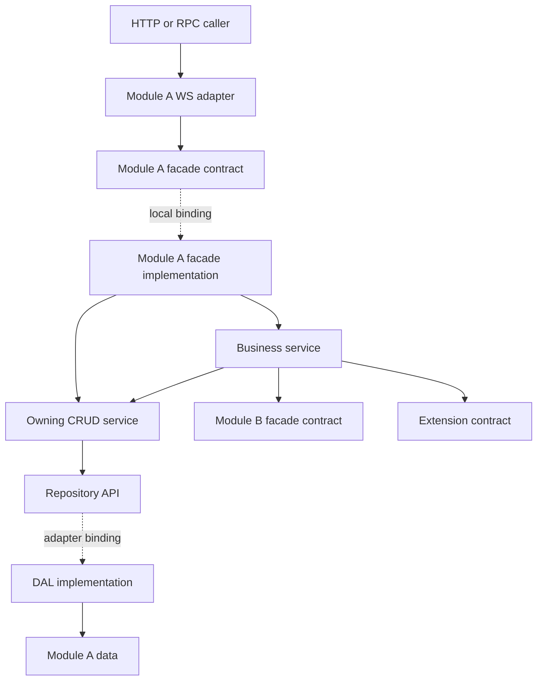

# Pyramid Architecture: concepts, implementation, and agent workflows

A comprehensive, technology-neutral guide to applying Pyramid Architecture to an application. It defines architectural responsibilities and decisions without requiring a particular framework, product, database, or repository.

All examples are illustrative. Adapt names, physical packaging, and executable tooling to the target application while preserving the relevant ownership and dependency rules.

## Contents

1. [Purpose, scope, and evidence](#1-purpose-scope-and-evidence)
2. [The four faces and the pyramid model](#2-the-four-faces-and-the-pyramid-model)
3. [Modules, layers, contracts, and dependency rules](#3-modules-layers-contracts-and-dependency-rules)
4. [Module autonomy and dependency graphs](#4-module-autonomy-and-dependency-graphs)
5. [Extensions, drivers, and shared capabilities](#5-extensions-drivers-and-shared-capabilities)
6. [Data models, references, queries, and persistence](#6-data-models-references-queries-and-persistence)
7. [Services and invocation contracts](#7-services-and-invocation-contracts)
8. [Interceptors, transactions, and consistency](#8-interceptors-transactions-and-consistency)
9. [Deployment elasticity and assembly](#9-deployment-elasticity-and-assembly)
10. [Tenancy, security, and operational context](#10-tenancy-security-and-operational-context)
11. [Code generation and source ownership](#11-code-generation-and-source-ownership)
12. [Designing portable contracts](#12-designing-portable-contracts)
13. [Applying the pattern across technology stacks and application types](#13-applying-the-pattern-across-technology-stacks-and-application-types)
14. [Framework-neutral worked example](#14-framework-neutral-worked-example)
15. [Implementation recipes](#15-implementation-recipes)
16. [Build, generation, and verification workflow](#16-build-generation-and-verification-workflow)
17. [Troubleshooting by symptom](#17-troubleshooting-by-symptom)
18. [Architecture review and acceptance criteria](#18-architecture-review-and-acceptance-criteria)
19. [Adoption, trade-offs, and architectural positioning](#19-adoption-trade-offs-and-architectural-positioning)
20. [Common misinterpretations](#20-common-misinterpretations)
21. [Provenance, portability, and maintenance](#21-provenance-portability-and-maintenance)

## 1. Purpose, scope, and evidence

Pyramid is a way to decompose software along both business and technical boundaries. A business module owns a cohesive capability and its data. Inside it, interface-separated technical layers narrow toward a published service facade. Modules collaborate through those facades. Applications assemble modules and infrastructure implementations into one or several processes.

The goal is to keep module code independent of deployment topology and storage implementation while making its capabilities discoverable to developers, generators, workflows, and agents.

Use three evidence categories throughout this guide:

| Category | Meaning | How an agent should use it |
|---|---|---|
| Architectural rule | Intended constraint described in the whitepaper | Apply in new designs; identify deviations in existing code without silently rewriting unrelated work |
| Observed implementation | Behavior or structure visible in the target application | Use to explain actual behavior; verify again after implementation changes |
| Convention or implementation guidance | Project conventions, illustrative syntax, or a practical way to realize a rule | Verify exact APIs and tooling before coding; do not claim it is already implemented |

The architecture is language-agnostic. Particular languages, frameworks, build tools, annotations, configuration formats, and directory names are implementation choices. Preserve responsibilities and enforceable boundaries in the target environment.

For architectural intent, prefer the whitepaper. For what a target application actually does, prefer its code, dependency graph, and configuration. Where they disagree, preserve both facts and explain the gap. Project-specific conventions do not become general architecture requirements.

Applicability: use these principles in web, mobile, desktop, CLI, worker, or other applications where modular boundaries are useful. Persistence, HTTP exposure, multitenancy, distributed deployment, AI, and BPM are optional capabilities. Apply their rules when those capabilities exist; do not introduce them solely to satisfy this guide. Section 13 explains how to map the roles to different environments.

## 2. The four faces and the pyramid model

| Face | Governs | Main mechanisms | Practical question |
|---|---|---|---|
| 1 — Structural | Business decomposition and technical isolation | Modules, layer subprojects, facade and DAL interfaces, data ownership | Can another module reach this module's internals? |
| 2 — Interaction / Connective | Coordination and replaceable shared capabilities | Extensions, drivers, entity/query interceptors | Can collaboration happen without coupling implementations? |
| 3 — Elastic | Distribution of modules across processes | Assembly manifests, layer bundles, local implementations and remote facade clients | Can this module move processes while retaining its contract? |
| 4 — Convergence | Automation and agent-facing capabilities | Typed catalogs, metadata, event observation, action graphs, BPM, audit | Can capabilities be discovered, proposed, approved, and executed through normal boundaries? |

These concerns operate together. Structural boundaries create stable extension and facade surfaces. Those surfaces permit alternate local/remote wiring. Metadata and interception make the resulting system understandable and observable to automation.

### 2.1 Two different meanings of convergence

**Structural convergence** means fine-grained persistence components are owned by services, services are aggregated by a facade, and external exposure delegates through that facade. **Face 4 convergence** means the combined structure supports higher-level automation. Do not confuse the two.



Solid arrows show use; dotted arrows show an implementation selected by assembly. A runtime call through an interface reaches a concrete implementation, while the caller's source dependency stays on the interface.

The whitepaper states a strict adjacent-layer Convergence Rule and forbids peer dependencies. Interpret it together with its more specific rules: business services may call CRUD services within `service-impl`, services may consume another module's facade, and shared `infra` types are used across layers. Those are logical responsibility levels and published contracts, even when they share a source package or build artifact. A literal ban on every same-artifact service call would contradict the intended design.

The facade is the module's service apex. WS is the external protocol adapter above that apex. Both descriptions can coexist; the caller does not need HTTP for an in-process facade call.

## 3. Modules, layers, contracts, and dependency rules

### 3.1 Canonical anatomy

A module implements the subset of these slots it needs. Empty remote-client slots can document a future seam; creating every possible adapter is unnecessary.

```text
module-example/
  shared-types/                  domain models, DTOs, refs, query types, identifiers
  data-access-contracts/         repository and external dependency ports
  adapters/relational/           optional relational storage implementation
  adapters/document/             optional document storage implementation
  adapters/external-api/         optional third-party service adapter
  adapters/messaging/            optional message transport adapter
  adapters/cache/                optional cache adapter
  service-contracts/             published facade contract
  services/                      facade implementation, owners, business services, hooks
  clients/remote/                optional remote facade implementation
  entrypoints/http-or-rpc/        optional protocol exposure
  entrypoints/ui-or-command/      optional local interaction adapter
```

The conventional names `infra`, `dal-api`, `service-api`, `service-impl`, `ws-rest`, and `service-rest-cli` used elsewhere in this guide denote these same roles. In the last name, `cli` means client; a command-line application is a separate entrypoint/assembly. Neither naming scheme is mandatory.

`infra` means shared foundational model types. It does not mean the place to put database or cloud infrastructure code. Concrete infrastructure belongs behind the DAL or extension boundary.

### 3.2 Dependency matrix

The table lists internal architectural dependencies. Runtime libraries and narrowly selected support libraries still need review; a permitted library must not expose a forbidden implementation transitively.

| Component | Permitted internal dependencies | Forbidden shortcuts |
|---|---|---|
| `infra` | Foundational core types and deliberately published contract types where needed | Framework services, database mappings, internal services, concrete adapters |
| `dal-api` | Own shared types and foundation contracts | Service layer, concrete DAL |
| Concrete DAL | Own `dal-api`, own types, appropriate core adapter support | Other modules' data or business services |
| `service-api` | Published input/output, reference, query, and error types | Repository interfaces, ORM entities, concrete services |
| Owning CRUD service | Own repository API and framework lifecycle support | Another module's repository or any concrete DAL |
| Business service | Owning CRUD services, published module facades, extension APIs | Direct repositories, internal services of another module |
| Facade implementation | Its internal CRUD and business services | Direct repository access or domain logic in the facade |
| `ws-rest` / `ws-grpc` | Own facade API and contract types | Service implementation, repository API, concrete DAL |
| `service-rest-cli` / `service-grpc-cli` | The facade API it implements, contract types, protocol libraries | Remote module's local implementation or storage |
| Driver | Extension SPI, driver-local types and optional DAL | Business modules, another driver, WS exposure |
| Assembly | Concrete variants and their APIs, launch/runtime configuration | Business rules |

### 3.3 Enforce boundaries with real mechanisms

Separate build artifacts prevent a forbidden import only when module visibility and the effective dependency graph actually deny access. Transitive dependencies can accidentally reintroduce implementation details. Inspect effective dependencies, not just direct entries or directory names.

Architecture tests supplement structural separation and run during verification; they are distinct from restrictions enforced by a compiler or module system. Test the intended WS/service/DAL, foreign-module, driver, and ownership boundaries. Tests only establish the rules and cases they actually exercise.

The assembly layer is intentionally allowed to depend on implementations. `app-base-ws` depending on `app-base-service` is assembly composition, not permission for a module's `ws-rest` source to import internal service classes.

## 4. Module autonomy and dependency graphs

Choose modules around cohesive business capabilities with clear data ownership. A module is not a table, controller, build aggregator, or deployment process. Related modules may form a development group without becoming one indivisible deployment unit.

Each module should be understandable and testable through its public contract. Its internal services, repositories, storage model, and persistence technology remain private implementation details.

### 4.1 Hard and optional dependencies

- A **hard dependency** must be available and active before the dependent module can activate.
- An **optional dependency** enables extra behavior when available; absence must have a defined fallback or disabled behavior.
- A module conflict declaration may be useful, but is not a core Pyramid requirement.

Distinguish four different graphs: build dependencies make classes available; runtime wiring chooses beans; module metadata declares activation requirements; tenant configuration determines which capabilities a tenant can use. None substitutes for the others. Optional bean injection alone does not prove tenant-aware optional activation.

Startup validation should resolve required dependencies before activation. Define initialization ordering and failure behavior in module metadata or equivalent composition logic. Verify the target framework implements the intended activation semantics.

### 4.2 Resolve cycles at the business boundary

If A needs B and B needs A, identify the shared capability and expose it through an extension contract, or reconsider whether the responsibilities belong together. Put the contract where both can depend on it without importing either implementation. Do not hide a true cycle behind lazy wiring or reflection.

An interceptor allows one module to react without forcing the producer to depend on the observer. Typed observers may still depend on published entity/event types and facades; interception does not eliminate all compile-time dependencies. Across processes, local interception requires an explicit event transport and receiving adapter.

## 5. Extensions, drivers, and shared capabilities

### 5.1 Extension responsibilities

An extension publishes a reusable capability and supplies coordination around it. Examples include files, notifications, messaging, sequences, authentication, workflow, and language-model access.

Its API defines what callers can ask for. Its implementation can validate requests, select implementors, apply tenant routing, prioritize providers, handle fallback, and manage capability lifecycle. Its optional WS adapter exposes system-level surfaces such as file downloads or callbacks.

Distinguish the **consumer API** from the **provider SPI** (service provider interface), even when both are published together. For example, a module might consume a notification-sending contract while providers implement a delivery-provider contract. The provider interface belongs to the extension, not to a concrete driver implementation.

### 5.2 Who supplies the capability?

| Implementor | Appropriate when | Owns |
|---|---|---|
| Business module | The capability requires domain rules and domain data, such as user identity | Business entities, rules, lifecycle, published facade |
| Driver | The capability is a technical implementation, such as console delivery or an external broker adapter | Provider integration and optional operational state |

A driver may persist delivery logs, offsets, or technical state in its own DAL. That does not make it a business module. Drivers do not expose WS or reach into module facades. If a driver needs business context, pass the required values through the extension contract, or assign the capability to a business module.

```text
Module A ──uses──> Extension consumer API
                         │
                  Extension orchestrator
                         │ selects through SPI
                         ├──> Driver X
                         ├──> Driver Y
                         └──> Business module implementor
```

Forbidden edges: module → concrete driver; driver → module facade; driver → driver; module A → another module's extension implementation class. Assembly may include all selected concrete artifacts.

Place business storage in its owning module and provider operational storage in its driver. Keep the extension focused on its contract and orchestration. Drivers have no WS surface. Verify any stricter project-specific storage restriction before treating it as a universal architectural requirement.

### 5.3 Selection and fallback are part of behavior

The manifest limits which providers are installed; runtime extension logic selects among them, potentially by tenant. A provider absent from the binary cannot be activated through tenant configuration alone.

Define what a failed delivery means, whether fallback is allowed, which channels it may use, and how duplicates are prevented. Provider replacement preserves caller code only if both implementations satisfy the same behavioral contract.

Fallback is explicit behavior. Do not send through an incompatible channel merely because another driver exists. Define which substitutions are acceptable, including any tenant routing constraints when multitenancy is supported.

## 6. Data models, references, queries, and persistence

### 6.1 Separate the representations

| Representation | Location | Responsibility |
|---|---|---|
| Domain entity | Module `infra` | Business data manipulated by services |
| Public request/response DTO | Shared published contract types | Stable boundary representation |
| Extended reference (`Ref`) | Shared contract/model types | Identifier and selected snapshot fields of another entity |
| Query builder and query data | Shared query types | Typed filtering and serializable query representation |
| Repository API | `dal-api` | Domain-oriented persistence operations |
| Storage entity | Concrete DAL | Database-specific shape and mappings |
| DAO / storage-engine repository | Concrete DAL | Low-level queries, indexes, persistence engine operations |

Conversion between domain and storage representations belongs in the DAL implementation. Do not return managed ORM entities, lazy proxies, sessions, or native database query objects through the facade.

Only intentionally published contract types cross facades. Storage entities remain private, and another module must not embed a foreign module's full domain graph. Use explicit request/response DTOs (data transfer objects) when boundary stability or data minimization requires them; domain-shaped published types can be appropriate when deliberately supported.

### 6.2 Extended references

An extended reference is a small owned snapshot of foreign identity and display data, often `id`, `name`, `shortName`, `longName`, `photo`, and a type discriminator. Actual fields depend on the model.

```text
Invoice
  id
  customer: CustomerRef { id, name, shortName }
  amount
  invoiceDate
```

The invoice module can display a customer label without a read-time join or a live call to customers. The reference does not transfer ownership of the customer. Resolve identity and validate it through the customer's public facade when required.

Decide whether each snapshot is historical or intended to track current values. A posted invoice may intentionally preserve the customer's name at issue time. For current snapshots, publish updates from the owner and refresh each consumer's local copies through consumer-owned services. Define the acceptable delay, replay/reconciliation behavior, and deletion handling.

Use a dedicated projection for complex cross-domain reporting; use a live facade lookup when highly volatile information must be current. Avoid adding every foreign field to every reference.

Use references for foreign identity-bearing relationships. A module may still contain its own value objects or aggregate children, such as order line items; those do not transfer ownership of another module's entities.

### 6.3 Queries and pagination

Prefer typed query contracts over raw provider query strings. A serializable query-data DTO is useful for remote requests; a typed builder or schema-validated query object supports service callers. Exact selector and builder classes are implementation choices.

For each queryable field, ensure agreement among entity metadata, query data, builder initialization/accessors, adapter query translation, serialization, and any indexes. Adding an annotation alone does not establish that all of those outputs exist.

Query interceptors can normalize ranges, expand hierarchical references, or constrain a query to the tenant. Preserve mandatory scope restrictions when applying caller-supplied filters. Expose pagination, limits, sorting, and stable result semantics in the published contract. Do not resolve cross-module queries by reaching into another module's database.

### 6.4 Cross-module reads

Use the least complex mechanism that meets the actual need:

1. Extended reference for ordinary labels and display-oriented filtering.
2. Service-level composition over published facades for bounded operational queries.
3. Dedicated reporting/read-model module or extension for large aggregations and repeated analytics.

A projection is a locally owned read model fed through published events or APIs. It does not authorize arbitrary joins into other modules' production tables.

### 6.5 Data ownership and schema evolution

Modules may share a physical server or database while owning distinct tables, schemas, or collection namespaces. They may also use different storage technologies within one process. Tenant isolation is a separate axis from module ownership.

Do not create cross-module ORM associations, database joins, or shared unit-of-work assumptions. Move an adapter's schema independently behind its repository API. A database switch also requires compatible mappings, migrations, query behavior, constraints, and data transfer; selecting a dependency does not migrate existing records.

## 7. Services and invocation contracts

### 7.1 CRUD service ownership

The intended model gives each entity repository exactly one owning CRUD service. All reads and writes go through that owner, including calls made by other services in the same module. The owner preserves lifecycle interception, audit, and transactional policy consistently.

The strict architecture separates mechanical persistence orchestration in CRUD owners from domain decisions in business services or interceptors. Existing systems may mix those responsibilities; identify the deviation without using it to justify scattered repository access.

An optimized query belongs in the repository implementation behind an API operation exposed by the owning service. Performance concerns do not require bypassing ownership.

### 7.2 Business services

Put business decisions, multi-entity workflows, state transitions, and coordination here. A business service calls the relevant CRUD owner for local entity data and the other module's facade for foreign capabilities. It can consume extension APIs for cross-cutting needs.

If multiple writes within one module must be atomic, define the transaction at the appropriate service workflow and ensure its local owners participate. Do not extend that transaction implicitly through a foreign facade.

### 7.3 Facades

The facade publishes the module's supported operations. Its implementation aggregates/delegates to internal services through explicit forwarding, composition, or a supported delegation mechanism. No particular annotation or code-generation feature is required.

Avoid turning the facade into a large business service or adding repository calls there. Keep input/output semantics, errors, access requirements, and sync/async behavior explicit. Changes to signatures or observable behavior require compatibility review; additive compatible operations need not always be breaking changes.

### 7.4 Protocol adapters and remote clients

WS maps protocol concerns—paths, verbs, parameters, serialization, status codes—to the facade. The remote client implements the same facade for callers in another process. It translates errors and absence consistently, propagates required context, and uses the target's actual protocol.

Third-party HTTP access behind a module's DAL is different from a remote Pyramid facade client. Both use HTTP, but their architectural contracts and locations differ.

### 7.5 Sync, async, and errors

Whether a call waits for completion is part of its contract. A synchronous operation can be implemented locally or with blocking RPC. An asynchronous operation needs defined acknowledgment, correlation, completion, and failure semantics, whether implemented with local workers or a remote broker.

CRUD is commonly synchronous; large imports or report generation may return a job handle. Transport replacement must preserve the chosen semantics.

The whitepaper favors typed outcomes for recoverable conditions and terminating errors for invariant violations. Existing examples also throw validation exceptions. Follow the actual established contract and map it consistently across local and remote implementations. Never turn every network error into “not found” or retry a mutation without considering duplicate execution.

## 8. Interceptors, transactions, and consistency

### 8.1 Entity lifecycle phases

The full conceptual phase set described by the whitepaper is:

| Lifecycle | Before phase | After phase | Purpose |
|---|---|---|---|
| Create | `BEFORE_ADD` | `AFTER_ADD` | Validate/enrich, then propagate creation |
| Update | `BEFORE_UPDATE` | `AFTER_UPDATE` | Validate changes, then refresh dependents |
| Logical deletion | `BEFORE_SOFT_REMOVE` | `AFTER_SOFT_REMOVE` | Hide operational data with restoration support |
| Physical deletion | `BEFORE_HARD_REMOVE` | `AFTER_HARD_REMOVE` | Validate permanent removal, then compensate/clean up |
| Restore deleted | `BEFORE_UNREMOVE` | `AFTER_UNREMOVE` | Validate and reactivate |
| Archive | `BEFORE_ARCHIVE` | `AFTER_ARCHIVE` | Transition to historical/retention storage |
| Restore archived | `BEFORE_UNARCHIVE` | `AFTER_UNARCHIVE` | Restore archived material |

Soft removal and archival have different business meanings. The precise storage policy is implementation-specific. The phase names above are conceptual labels: implement only the lifecycle states the application needs, and verify how its actual hooks map to those semantics.

### 8.2 Lifecycle placement and failure

A before interceptor can validate or enrich and abort the primary operation. An after interceptor coordinates consequences. Under the whitepaper's intended after-commit semantics, a failed after action cannot undo the committed primary write; it needs retry, compensation, or reconciliation.

Check real transaction placement before promising this behavior. A callback immediately after `repository.save()` can still be inside an outer transaction. An annotation name or a source comment saying “committed” does not establish durability. Where after-commit behavior matters, use a verified transaction-completion mechanism or a durable event/outbox design appropriate to the implementation.

A synchronous after-save callback that rethrows a side-effect failure can surface a failed request after a durable write and stop later callbacks. Define that outcome deliberately. Callback dispatch alone does not establish durable delivery, retries, compensation, or exactly-once effects.

### 8.3 Design constraints

Keep each interceptor focused on one concern. Prefer independence from other interceptors' order. Where sequencing is required, declare and test it explicitly; do not infer order from automatic component discovery.

For cross-module side effects, define identity and tenant propagation, duplicate handling, event ordering/versioning, failure visibility, and ownership of retries. Asynchronous notifications can improve response time, but reliable delivery requires an actual durable mechanism. An in-memory event bus does not survive process loss.

Before-phase remote checks are subject to races. “Available when checked” does not guarantee availability at commit; enforce reservations or concurrency rules in the module that owns the resource if the business operation requires them.

### 8.4 Query interceptors

Query interception transforms criteria before adapter execution. Examples include tenant restrictions, date normalization, and expanding an institution filter to descendants through the institutions facade. Avoid recursive service queries that re-enter the same interceptor indefinitely. Query transformations must preserve authorization and predictable pagination semantics.

### 8.5 Transactions and sagas

The intended atomic boundary is a single module. Cross-module calls have independent commit outcomes even when modules are co-located. Framework transaction propagation must be configured to make that true; facade interfaces alone do not enforce it.

A saga-like workflow records primary outcomes and compensating actions rather than claiming distributed ACID. Example: order creation succeeds; stock reservation fails; a defined workflow marks the order rejected or compensates the reservation. A compensation is a new business operation that may itself fail, not a guaranteed rollback of history.

If two responsibilities must always commit atomically, reconsider whether they are one module. Repeated cross-module atomicity requirements often reveal an incorrect boundary.

### 8.6 Intentional suppression

For a controlled migration or test setup, use a scoped suppression mechanism while retaining service ownership. Do not bypass the owner and call repositories to silence hooks.

A suppression scope must restore prior context even when the operation fails. Thread-local or request-local suppression does not automatically cross asynchronous tasks or remote calls. Use the target implementation's actual scoped-context mechanism and test its lifetime.

## 9. Deployment elasticity and assembly

### 9.1 M modules across P processes

| Deployment | Meaning | Typical motivation |
|---|---|---|
| M/1 | All modules co-located in one application process: a modulith | Low operational overhead and rapid iteration |
| M/P | Modules partitioned across selected processes | Independent scaling or selected isolation |
| One module per process | Full separation of logical modules | Independent ownership, operations, or isolation requirements |

The whitepaper calls the last case `1/P`. Read that as its descriptive shorthand for one module per process, rather than literal arithmetic for a fixed total of M modules. With one instance of each of M modules, there are M module processes; replication adds instances independently.

Co-deployment requires compatible runtimes. Heterogeneous technologies can still implement the published protocols, but cannot automatically share one process. Architecture does not remove that constraint.

### 9.2 The composition root

An application manifest describes included modules, extensions, drivers, service implementation choices, DAL/WS variants, and versions. Syntax is implementation-defined. It drives assembly generation or equivalent dependency composition.

Layer bundles aggregate selected implementations across modules; packaging artifacts combine bundles into deployables:

```text
service-bundle         -> module/extension/driver service implementations
web-bundle             -> service-bundle + chosen web/RPC adapters
relational-bundle      -> chosen relational storage adapters
document-bundle        -> chosen document storage adapters

web-application        -> web-bundle + chosen storage bundle
command-application    -> service-bundle + command entrypoint + chosen storage bundle
worker-application     -> service-bundle + event entrypoint + chosen storage bundle
```

Other storage variants follow the same pattern. A tool still needs a persistence implementation if its services use storage, but can omit HTTP exposure and unrelated background processes.

### 9.3 Extracting a module

Keep the public facade stable. In the producer assembly, include its WS, local service implementation, DAL, and required support. In each consumer assembly, bind that facade to its remote client and remove the producer's local implementation and DAL from the consumer's composition.

Configure endpoints, bean selection, context propagation, serialization, authentication, and failure behavior. Ensure the local and remote implementations do not both satisfy injection ambiguously. Data ownership stays with the producer; physical database relocation, if needed, remains an operational migration.

The promise is that business callers can remain unchanged. It is not a promise that latency, timeouts, availability, delivery semantics, or transaction behavior disappear. A reserved client slot is useful only once a compatible client actually exists and is tested.

Returning to a modulith reverses the binding and assembly choices. Preserve module data and transaction boundaries so re-co-location does not create new shortcuts. Independent version deployments require contract compatibility in both directions during rollout.

## 10. Tenancy, security, and operational context

### 10.1 Three composition stages

1. **Build/assembly:** determines which artifacts and providers are present.
2. **Application startup:** creates implementations and validates installed capabilities and required configuration.
3. **Tenant activation and invocation:** resolves enabled module sets, tenant configuration, identity, data routing, and provider selection according to the framework.

The whitepaper allows tenant-specific module sets, data sources, and driver bindings. Do not infer that every implementation supports live reconfiguration, every storage pairing, or all variants within a single binary.

Multitenancy is optional. When required, choose and verify an isolation strategy such as separate databases, schemas, or enforced tenant partitioning. Module ownership remains a separate requirement. Configuration describing isolation is not proof of runtime isolation.

### 10.2 Keep context across boundaries

Facade calls, interceptors, asynchronous work, and remote clients need the appropriate tenant, principal, authorization context, and correlation/audit identifiers. Perform capability checks at execution time as well as discovery time, because tenant activation and user permissions may differ.

Separate database ownership from security. A private repository dependency does not itself authorize a caller. Likewise, a tenant configuration entry is not proof of a usable module if the binary lacks the implementation or its hard dependencies.

Seed services should be repeat-safe and tenant-scoped when multitenancy applies. “Runs on module startup” does not mean “runs once forever.” Deferred dependency initialization can address lifecycle wiring but must not hide an actual module cycle.

### 10.3 Face 4: tools, observations, and action graphs

Typed facades can supply tool names, input/output schemas, descriptions, error semantics, and required capabilities. Module metadata and manifests can describe the active dependency graph. Generator output must be tied to the actual deployed version and tenant surface.

Interceptors or schedulers can observe domain activity and trigger an agent to propose work. Use asynchronous delivery when the observation need not block the business transaction. An observer should consume the minimum necessary context through established interfaces.

The whitepaper proposes an **action graph**: a DAG of facade invocations. Each node identifies the operation, arguments, reasoning, confidence, and dependencies. Human review may approve, reject, or modify nodes; rejection invalidates assumptions of dependents. Execution occurs through normal service boundaries under an identifiable AI principal.

For an implementation, validate unique node IDs, known dependencies, acyclicity, argument types, operation allowlists, current approval, tenant access, and result binding. Choose a dependency-respecting execution order; record outputs and failures; prevent duplicate effects on restart/retry. A Boolean `approved` received in an arbitrary payload is not by itself an authenticated approval record.

BPM can map nodes to service tasks and approvals to human tasks. The workflow extension defines the contract; a driver supplies an engine. Reusable generated processes require validation and deployment approval before unattended recurrence. Typed method existence alone does not prove a process is semantically valid.

Audit can record proposals, human modifications, approvals, rejections, calls, and outcomes. Those records can support evaluation or learning if an explicit data pipeline and appropriate access/retention policy are implemented. The existence of audit tables does not automatically train a model.

LLM providers fit the same extension/driver split. Local, cloud, or hybrid inference is a deployment choice, subject to tenant data-routing requirements. A local model driver alone does not establish sovereignty if telemetry, tools, or fallback still export data. These are design requirements for that capability, not proof that an application already implements LLM or BPM capabilities.

## 11. Code generation and source ownership

### 11.1 Inputs and outputs

The intended sources are entity definitions, published operations/facades, and application composition metadata. Business logic and interceptors remain authored code. A generator may derive:

| Input | Potential outputs |
|---|---|
| Entity/model definition | References, query builders/data, repository APIs, storage mappings, mechanical CRUD |
| Published service/facade definitions | WS adapters, remote clients, frontend clients, tool catalogs, BPM delegates |
| Module and facade metadata | Capability descriptions and dependency documentation |
| Application manifest | Build dependency sections and deployable assembly |

This table describes possible generation pipelines. Do not assume one command produces every output. Some implementations author a facade contract directly; others derive it from explicitly selected public service operations. Establish the authoritative direction and avoid circular generation ownership.

### 11.2 Determine the unit of ownership

| Evidence | Editing rule |
|---|---|
| Entire file is generated | Change source metadata/template; regenerate output |
| Marked generated dependency block | Change manifest; preserve manual content outside the block |
| Mixed file with generated methods | Verify generator merge/preservation rules before edits |
| Unmarked hand-maintained contract | Edit directly and update dependents as the project requires |
| Explicit preservation control | Verify exact supported preservation mechanism, scope, and version before relying on preservation |

A generated-ownership marker is evidence of ownership intent, not proof that every generator currently knows how to rebuild the file. If a necessary generator or source is missing, identify it and avoid pretending a manual output patch completes the pipeline. For a task explicitly requiring a temporary repair, document its regeneration risk and source follow-up.

### 11.3 Generated build sections

A generator can own a marked section inside a larger build/configuration file. The marker syntax is implementation-defined; for example:

```xml
<!-- [GENERATED:pyramid] DO NOT EDIT BELOW -->
<!-- generated dependency entries -->
<!-- [/GENERATED:pyramid] -->
```

Keep generated dependency declarations easy to inspect. Manual content outside the generated region has a separate owner. Inspect the generator before assuming it preserves every unmarked region; do not impose a universal ban on editing all build files.

After regeneration, review changes for dependency direction, variant selection, versions, public API changes, removed custom methods, and unrelated churn. Check a second generation for unwanted drift when generator behavior itself is being changed. Compile generated consumers where the change could invalidate them.

### 11.4 Generation is not conformance proof

Templates can generate incorrect APIs, unsafe HTTP mappings, or wrong dependencies repeatedly. Treat the generator as a maintained component with focused tests. Keep generated diffs reviewable and use architecture checks independently of generation.

Do not turn the intended “safe to rerun” property into a guarantee about an uninspected generator. Check whether it handles changed signatures, removed operations, renamed fields, preserved custom sections, and reproducible output.

## 12. Designing portable contracts

### 12.1 Define behavior before syntax

A facade operation needs a stable name, purpose, inputs, outputs, expected failures, access requirements, and completion semantics. Define whether it creates a new resource, updates an existing one, is repeat-safe, or starts work that completes later. Document preconditions and effects rather than exposing every internal helper.

Contracts can be language interfaces, exported module APIs, protocols, schema definitions, or message contracts. A concrete class can satisfy a contract through structural typing or an adapter; inheritance is not required. Dynamic-language implementations still need explicit callable surfaces and runtime validation at external boundaries.

### 12.2 Keep transport concerns at the edge

Internal callers should not construct HTTP responses, database queries, or provider-specific request types. A remote adapter translates the published contract to the chosen protocol. Define absence, validation failure, conflict, unavailable dependency, and unexpected failure distinctly; preserve those distinctions across local and remote implementations.

Choose stable representations for identifiers, dates, money, enums, pagination, and optional fields. Do not assume every target language preserves integer precision, nullability, or timestamps in the same way. Remote boundaries require deliberate serialization; an in-process object reference is not a portable representation.

### 12.3 Evolve contracts deliberately

An additive optional field may be compatible while a new required field, changed error meaning, removed operation, or altered completion behavior may break consumers. Check actual consumer expectations. During independent deployments, support the overlapping versions required for the rollout and retain an explicit retirement policy where needed.

Contract tests can run the same behavioral expectations against local implementations and remote adapters. Include error and absence cases, not only successful requests. A shared interface proves a signature relationship; it does not establish identical network behavior.

### 12.4 Metadata belongs to capabilities

Keep useful descriptions, validation rules, visibility/exposure intent, and authorization requirements alongside the authoritative capability definition or in a maintained schema. Generate clients, catalogs, and documentation from that source when tooling supports it. Framework annotations are one possible representation; decorators, attributes, schemas, or explicit registration are alternatives.

Do not publish operations simply because a reflection mechanism can discover them. Select the intended public surface and validate generated exposure against it.

## 13. Applying the pattern across technology stacks and application types

The architecture specifies responsibilities and boundaries. It does not require a particular language, framework, database, code generator, dependency-injection container, or directory tree. Names such as `infra`, `dal-api`, and `service-api` in this guide are illustrative role labels.

### 13.1 Map concepts to the target environment

| Pyramid concept | Possible realization | Invariant to preserve |
|---|---|---|
| Business module | Package, library, workspace component, assembly, bounded service | Own business responsibility and data |
| Shared types | Types-only package, records, schemas, value objects | No dependency on implementation layers |
| Facade API | Interface, protocol, exported functions, schema-defined API | One deliberate published capability surface |
| DAL API | Repository interface, protocol, abstract port, injected function set | Service logic is independent of storage implementation |
| Concrete adapter | Driver package, repository implementation, plugin | Provider details stay behind the port |
| Facade implementation | Delegating object, explicit forwarding functions, module exports | Aggregate owning services without bypassing them |
| Extension | Capability API plus routing/orchestration | Consumers depend on the capability contract |
| Driver | Plugin/provider implementation | No business-module or driver-peer dependency |
| Interceptor | Explicit lifecycle dispatcher, hooks, middleware around owning operations | Consistent phase, context, failure, and ownership semantics |
| Assembly | Composition function, dependency container, configuration manifest, build target | Concrete selection occurs outside business logic |
| Enforcement | Module visibility, package exports, dependency rules, static analysis, architecture tests | Forbidden dependencies are actively checked |
| Generation | Template/AST/schema tooling or initially manual equivalents | Clear ownership and synchronized contracts |

Physical separation must provide real restrictions. Directories alone do not prevent forbidden imports. Choose enforcement appropriate to the language and build system, and explain any gaps it cannot prevent automatically.

### 13.2 Adapt the entrypoint to the application

| Application | Typical incoming adapter | Typical outgoing adapters |
|---|---|---|
| Web API | HTTP, RPC, webhook handler | Databases, external APIs, broker |
| Desktop application | UI presenter/controller, local command handler | Local storage, operating-system services, remote APIs |
| Mobile application | View model/presenter, background job handler | Local store, device APIs, remote facade clients |
| Command-line or batch tool | Command parser, scheduled-job entrypoint | Files, databases, external services |
| Worker or event processor | Subscription/event consumer | Owned storage, published module APIs, event transport |
| Embedded or offline application | Device/event adapter, local UI | Hardware interfaces, local persistence |

A UI or command adapter translates interaction into facade calls just as a WS adapter translates HTTP. It need not introduce an HTTP server. UI state, rendering, and interaction concerns belong to the presentation side; domain operations belong behind the capability surface. This pattern does not prescribe a frontend styling system or replace accessibility and interaction design.

Client applications must respect remote data ownership. A local cache is a client-owned projection, not permission to bypass the server's facade. Authentication and authorization must be enforced at the trusted boundary; checks in a browser or mobile UI alone are insufficient.

### 13.3 Use only the capabilities the application needs

A stateless module need not invent entities, repositories, or transactions. A local tool need not implement network exposure. A single-tenant application need not acquire a tenant subsystem. AI catalogs, BPM, brokers, and remote deployment adapters are capabilities to add when the product needs them.

Keep the applicable ownership and contract rules when omitting unused slots. A small application can begin with a few enforceable modules and handwritten wiring. Separate artifacts and generation are useful when they provide clear enforcement or maintenance benefits; creating many empty projects is not itself conformance.

Pyramid can be applied across application types, but it is not automatically the best cost/benefit choice for every application. Match the depth of structure to the product's complexity and expected evolution.

## 14. Framework-neutral worked example

This illustrative order workflow uses generic capability names and pseudocode. It is not tied to a supplied repository or a required commerce domain; the same boundaries apply to bookings, document approvals, device jobs, or other workflows.

### 14.1 Assign ownership

- Orders owns order state, its repository API, its CRUD owner, and order business services.
- Inventory owns availability and reservations; only its facade can reserve or release stock.
- Notifications publishes a sending contract and selects a provider through its SPI.
- The application assembly chooses local/remote facade implementations and notification providers.

### 14.2 Trace an operation

```text
HTTP / UI / command adapter
  -> Orders facade.placeOrder(request)
    -> PlaceOrder business service
      -> validate local business inputs
      -> Order CRUD owner creates pending order
        -> before-create hooks
        -> Order repository API -> selected storage adapter
        -> verified after-commit delivery of order-created event
      -> coordinate Inventory facade.reserve(items, operationId)
      -> Order CRUD owner records confirmed or rejected outcome
      -> notification workflow calls Notifications API
        -> extension selects provider -> delivery result
```

This is a workflow with independently committed module operations. The exact timing can be synchronous or asynchronous as declared by the contract. Define intermediate states and recovery before implementation; do not pretend an order and a remote reservation are one database transaction.

### 14.3 Repository ownership in pseudocode

```text
contract OrderRepository:
    load(id) -> optional Order
    save(order) -> Order

component OrderCrudOwner:
    depends on OrderRepository and lifecycle support
    create(order): perform the defined lifecycle and persist through repository
    update(order): perform the defined lifecycle and persist through repository
    find(id): return repository.load(id)

component PlaceOrderService:
    depends on OrderCrudOwner and InventoryFacade
    place(request): coordinate the declared workflow through those contracts

component OrdersFacade:
    placeOrder(request): delegate to PlaceOrderService.place(request)
```

The business service has no direct repository dependency. The storage adapter can change without changing its callers. The inventory facade can switch between a local implementation and a remote client without changing the caller's operation vocabulary.

### 14.4 Account for failure and retries

If reservation fails, record the order's defined rejection/pending-retry state. If reservation succeeds but confirmation fails, retain enough workflow state to retry confirmation or release the reservation. Correlate retries with an operation identity and design the inventory operation to handle duplicate requests if retries are possible.

A before-operation availability check cannot replace an atomic reservation in the inventory owner. Notifications should not silently change the outcome of an already confirmed order; define separate delivery status and recovery when delivery is required.

### 14.5 Select the deployment

In a modulith, assembly binds `InventoryFacade` to a local implementation. After extraction, it binds the same contract to a remote adapter and supplies an endpoint and context propagation. The inventory producer includes its own incoming adapter, implementation, and storage adapter. Equivalent contract behavior must be verified in both arrangements.

## 15. Implementation recipes

Each recipe assumes the user requested the change and the agent has located its actual owner and generation source. Adapt it to the target repository; do not scaffold absent framework code into an assembly repository.

### 15.1 Add or modify an entity field

1. Identify whether it belongs to the local domain, a boundary DTO, an extended reference, or storage-only metadata.
2. Edit the authoritative model. For a foreign entity relationship, use a reference or explicit contract DTO with the required fields.
3. If queryable, update or regenerate query data, builder selectors, serialization, and adapter translation.
4. Update or regenerate every supported storage representation and mapping; consider null/default behavior for existing records and necessary schema/index migration.
5. Update public responses, clients, and schemas if the field is published. Decide whether old clients and old data remain valid.
6. Verify persistence round-trip and meaningful query behavior for affected adapters. Check reference freshness behavior if this changes a snapshot.

Do not assume a generated storage model “automatically picks up” a field without locating and running the relevant generation process.

### 15.2 Add a business operation

1. Define the owning module, operation inputs/outputs, errors, authorization, and sync/async semantics.
2. Put domain logic in a business service; call local CRUD owners, foreign facades, and extension APIs as needed.
3. Register delegation in the facade implementation and update the actual facade source. In a pull-up project, regenerate the interface from its owning service source.
4. Expose through WS only if it is intended as a remote/public capability. Generate or implement matching remote clients and frontend/tool contracts as appropriate.
5. Test the business rule, failure outcome, and compatibility of any affected remote representation.

An internal helper should not accidentally become public because a delegate generator exports every public method. Inspect exclusion metadata and resulting contract diffs.

### 15.3 Add an entity

Define its identity, lifecycle, ownership, references, and whether it is hierarchical. Create the domain model and required query/ref types. Add a repository API, supported adapters, and exactly one owner. Put nonmechanical rules in the appropriate business/interceptor layer. Register facade operations, exposure, mappings, and generation sources. Verify lifecycle events fire once and that all supported assemblies can supply the repository implementation.

### 15.4 Add a business module

Choose a cohesive boundary and declare data ownership first. Define hard and optional dependencies without cycles. Create the required layer slots and a published facade using the target project's existing template or conventions. Add local implementation and DAL; reserve a remote slot when useful.

Add composition metadata and generated dependencies at the assembly level. Include required WS, default configuration, and tenant activation where applicable. Add architecture checks for the new boundary and behavior tests for its actual operations. In an assembly-only project, adding a manifest entry consumes a module artifact; it does not implement that module.

### 15.5 Add or replace a driver

Define the extension consumer contract and provider SPI, or reuse the established one. Keep module calls on that contract. Implement technical behavior and any driver-local persistence. Register it through the extension's discovery mechanism and assembly. Specify priority, capability matching, tenant routing if supported, fallback, and failure results.

Test the provider contract and selection behavior without adding direct dependencies from business modules to the driver. A driver needing business records is a signal to pass data through the API or move the capability to a business implementor.

### 15.6 Add an interceptor

Select the entity/event type, phase, registering owner, and one responsibility. Locate how hooks are actually dispatched. Make before-phase checks abort before the intended write; define after-phase delivery and recovery behavior. Call local owners or foreign facades, and retain tenant/principal context.

Test the successful path, abort/failure path, ordering if required, repeated delivery if possible, and suppression restoration where relevant. Avoid observer cycles and repeated propagation of unchanged values.

### 15.7 Add a cross-module report

Use an extended reference when it already contains the needed snapshot. For bounded data, compose facade queries with explicit limits. For repeated high-volume reporting, define a consumer-owned projection fed by published changes and a rebuild process. State consistency/freshness and pagination semantics. Do not solve it with SQL against another module's schema.

### 15.8 Change DAL or packaging

Confirm the required concrete adapter exists for each included module/driver. Change the actual manifest/assembly input and regenerate its managed dependencies. Choose the matching packaging artifact and runtime configuration. Verify storage mappings, query semantics, migrations, and service behavior. Keep business service dependencies on `dal-api`.

Switching server packaging or moving to a command-line tool changes assembly and lifecycle; it does not justify moving business logic into a launcher. Switching database technology requires a data transition plan when records already exist.

### 15.9 Extract or re-co-locate a module

Check for foreign repository/table access, shared ORM context, implicit shared transactions, nonserializable facade types, and missing remote methods. Build the producer and consumer assemblies described in section 9. Verify implementation selection is unambiguous, endpoint configuration, error mapping, tenant/security context, and retry semantics.

Exercise a representative operation through the remote client, including absence and failure behavior. For the reverse transition, replace the remote binding with local wiring while preserving the same contract and independent ownership.

### 15.10 Add AI or BPM integration

Publish only actual intended facade capabilities, with useful schemas and semantics. Filter the catalog to the active tenant and authorized surface. Observe through existing lifecycle/event mechanisms. Implement proposal, validation, approval, and execution as separate responsibilities with traceable identities and outcomes.

Implement and verify the specific execution, identity, binding, and approval behavior required by the capability. The existence of dispatcher or generator classes does not establish completeness.

## 16. Build, generation, and verification workflow

Use the target application's actual tooling. This architecture does not prescribe executable command names, a dependency manager, or a test runner.

### 16.1 Discover the real project workflow

Locate repository instructions, package/build descriptors, exported APIs, composition roots, generation configuration, and test setup. Identify which artifacts are authored and which are generated. Inspect effective dependencies, including transitive exposure and runtime/plugin loading.

Determine how the target environment checks dependency boundaries: compiler/module visibility, lint/static analysis rules, build constraints, or executable architecture tests. Record what each mechanism can prove. A successful compile is not a complete architecture review.

### 16.2 Regenerate only the affected outputs

Identify the owning source and supported generator command before running it. Inspect output locations and preservation rules, then regenerate the affected contracts, adapters, clients, or composition metadata. Review the resulting diff and verify consumers. If the generator is unavailable, state the missing dependency and the limits of any temporary manual repair.

### 16.3 Build and run in the intended environment

Choose the relevant build target and dependencies rather than assuming every module or deployment variant shares the same entrypoint. Verify toolchain compatibility and real test discovery. Run integration behavior against appropriately isolated storage and services; do not infer runtime correctness solely from configuration names.

Architecture documentation work does not require launching applications or executing deployment/migration actions. Implementation work should validate the actual affected behavior and required project checks.

### 16.4 Match validation to the behavior changed

| Change | Useful verification |
|---|---|
| Contract or facade operation | Compile callers, local behavior, serialization and remote/error mapping |
| Persistence field/query | Adapter mapping round-trip, filtering, schema/constraint behavior |
| Interceptor | Trigger exactly once, precondition abort, after-failure outcome, order/retry behavior if relevant |
| Dependency or module addition | Effective dependency visibility and applicable architecture tests |
| Tenant/configuration selection | Enabled/disabled capability and correct tenant/provider/data routing |
| Generator | Representative output compilation, preservation, repeated-run stability |
| Action graph | Approval enforcement, dependency/cycle checks, argument validation, failure and replay behavior |

If a dependency, framework source, or build environment is missing, report exactly what was verified statically and what remains unverified. Do not substitute “compiles” for “behaves correctly” or “tests passed” for “all architecture rules enforced.”

## 17. Troubleshooting by symptom

| Symptom | Likely boundary or configuration to inspect | Appropriate response |
|---|---|---|
| Repository implementation missing | Selected DAL bundle, adapter availability, scanning | Repair assembly/adapter registration; keep services on repository API |
| Two facade implementations match dependency resolution | Local and remote variants both active | Correct assembly or explicit selection |
| New service method absent at WS | Facade source/delegation, generation exclusions, controller sync | Trace each publication step; regenerate the authoritative outputs |
| New field vanishes after save | Domain/storage conversion or generated model drift | Update mapping and generation source; verify round-trip |
| Query accepts a field but ignores it | Query-data conversion, selector copy, adapter translation | Repair the complete query path |
| Tenant capability absent | Installed artifacts, module aliases, hard dependencies, activation config | Reconcile all graphs rather than editing one list blindly |
| Remote lookup reports absence during outage | Client catches transport errors as empty | Preserve distinct not-found and unavailable semantics |
| Request fails but record exists | After-write side effect throws | Determine transaction commit, expose outcome, add defined recovery |
| Lifecycle side effect runs twice | Framework hooks plus manual dispatch, retries, duplicate consumers | Establish one dispatch path and idempotent consumption |
| Architecture test passes but forbidden import compiles | Transitive dependency exposure or incomplete test scope | Inspect dependency tree and extend relevant boundary coverage |
| Source change disappears after regeneration | Wrong ownership region or unsupported preservation mechanism | Edit the generator source/template/metadata |
| Module needs another module's SQL | Missing published operation or projection | Add facade capability or consumer-owned read model |
| Driver needs a module service | Misplaced business responsibility | Pass context through SPI or use a business module implementor |
| Graph node fails despite dependency appearing later | Input-order executor, not DAG scheduler | Validate/order the graph or implement a scheduler |
| Build succeeds with no meaningful tests | Commented tests, nonstandard directories, missing discovery | Inspect test counts and source/resource registration |

## 18. Architecture review and acceptance criteria

Apply the relevant checks to the requested work. This is a conformance checklist, not a requirement to change every pre-existing deviation in a narrow task.

### Structure and ownership

- Each changed business capability and entity has a clear owning module.
- WS calls the facade and has no domain/persistence logic.
- Facades delegate; business services use CRUD owners; each entity repository has one owner.
- Foreign interactions use published facades/extension APIs, never foreign storage or internal services.
- Shared types do not expose database sessions, ORM entities, or provider SDK objects.
- Effective build dependencies and applicable architecture rules match the intended boundaries.

### Interaction and consistency

- Modules and drivers communicate through extension contracts; driver isolation is preserved.
- Lifecycle hooks fire through the established mechanism, with explicit phase and failure behavior.
- Transactions remain module-local; cross-module partial failures have a defined outcome.
- References/projections have explicit historical/current meaning and update/rebuild strategy where needed.
- Async and retry behavior preserves tenant context and handles duplicate delivery when applicable.

### Assembly and generated artifacts

- Concrete variants are selected in assembly and have unambiguous wiring.
- Hard/optional dependencies and tenant activation are consistent with installed artifacts.
- The manifest/generator source is updated alongside generated output.
- Manual regions and business logic survive regeneration.
- Storage/topology changes preserve facade semantics and include necessary data/runtime configuration work.

### Automation surfaces

- Catalogs describe available published operations with current argument/response semantics.
- Generated operations are not assumed safe or authorized solely because they are typed.
- Action dependencies, approvals, execution identities, and outcomes are enforced by implemented code.
- Descriptions distinguish implemented behavior from proposed LLM/BPM features.

Report findings as rule, evidence, impact, and correction. Example: “Order service imports catalog's repository API; this exposes catalog data outside its facade and prevents independent storage ownership; expose the required query through catalog's owning service/facade and remove the DAL dependency.”

## 19. Adoption, trade-offs, and architectural positioning

### 19.1 Adopt in increments

For a legacy monolith, choose one coherent new or extracted capability. Give it `infra`, `dal-api`, `service-api`, `service-impl`, required adapter, and WS boundaries. Enforce dependency direction. Introduce generation only once the shape and ownership are understood; hand-maintained contracts are a legitimate first step.

For existing microservices, identify stable facade contracts and data ownership, then make service assembly and remote clients explicit. For a greenfield system, a modulith often provides a simple first deployment while keeping extraction seams.

Add extensions when a real shared capability emerges. Extract processes when load, isolation, ownership, or operations justify it. Avoid using the adoption checklist's suggested scores or timelines as guarantees for a particular team.

### 19.2 Costs and limits

| Trade-off | Consequence | Architectural response |
|---|---|---|
| More subprojects and concepts | Onboarding and build-management cost | Consistent anatomy, focused documentation, generation where useful |
| Strict data ownership | Cross-domain joins become composition/projection work | Extended references and purpose-built read models |
| Module-local transactions | Cross-module partial success | Defined workflow state, compensation, durable delivery where needed |
| Remote facade substitution | Network and deployment failure modes | Explicit timeout/error/idempotency/context contracts and integration verification |
| Generated structure | Template defects can spread widely | Version/review generators and validate representative output |
| Snapshot references | Stale or historically frozen information | Deliberate freshness policy and consumer-owned refresh logic |
| Optional tenant composition | More activation combinations | Dependency validation and targeted configuration coverage |

The architecture supports modular reasoning and operational options; it does not prove linear complexity growth, independent certification, compliance, perfect data isolation, or automatic AI readiness by naming conventions alone.

### 19.3 Relationship to other approaches

Pyramid uses dependency inversion familiar from Clean and Hexagonal Architecture. Its module boundary resembles a DDD bounded context, and its facade a published contract. It does not require every DDD tactical pattern. An extension's active orchestration and the explicit module/driver isolation add concrete coordination rules.

Microservices is a possible deployment of Pyramid modules. A modulith is another. The distinctive emphasis is making the facade a deliberate migration seam, expressing topology in assembly, enforcing technical boundaries through artifacts and checks, and reusing typed contracts for generation and automation.

Do not repeat the whitepaper's comparative table as proof that other architectures cannot enforce boundaries or support flexible deployment. Explain the concrete choices Pyramid prescribes and assess the actual implementation.

## 20. Common misinterpretations

| Misinterpretation | Correct application |
|---|---|
| Pyramid means a mandatory Java-style project tree | Preserve logical boundaries using the target environment's enforceable constructs |
| Every module must have a database and HTTP API | Instantiate only relevant layers and adapters; stateless/local modules are valid |
| A facade is just another name for a controller | The facade is the protocol-independent capability contract; the controller translates transport |
| Any call within `service-impl` violates the no-peer rule | Respect logical levels: business services may call owning CRUD services |
| Shared contract types permit shared repository access | Sharing a DTO/reference does not transfer storage ownership |
| Drivers may call business modules to obtain context | Pass context through extension contracts or assign the capability to a business implementor |
| An interceptor removes every dependency between modules | Observers can depend on published types/contracts; producers need not know observer implementations |
| A callback named AFTER guarantees durable commit | Verify actual transaction-completion behavior and delivery mechanism |
| Same process means one cross-module transaction | Preserve module-local transaction boundaries in every topology |
| A remote proxy makes network calls equivalent automatically | Test serialization, errors, retries, identity, and availability behavior |
| A generated file proves full generation support | Inspect the generator's real inputs, outputs, and preservation behavior |
| Folder separation proves compile-time isolation | Check effective imports, exports, dependency graph, and enforced rules |
| A typed tool schema authorizes execution | Validate capability access, arguments, identity, and required approval at invocation |
| Every application needs AI, BPM, tenancy, and microservices | These are supported capability/deployment choices, not compulsory product features |
| Modularity guarantees compliance or perfect scalability | Establish those properties through actual implementation and operational evidence |

When applying the architecture, distinguish an intended rule, evidence of implementation, and a proposed improvement. An illustrative pattern is not proof of behavior in the target application.

## 21. Provenance, portability, and maintenance

This guide adapts **Taha BEN SALAH (2026), The Pyramid Architecture Whitepaper v1.0**. The source repository is identified by the supplied documentation as `https://github.com/thevpc/the-pyramid-architecture`. Its README states that documentation is CC-BY-SA 4.0 and example code is MIT. This documentation adaptation is distributed under **Creative Commons Attribution-ShareAlike 4.0 International (CC-BY-SA-4.0)**.

The guide reorganizes the architecture for agent use, explains implementation decisions, and qualifies claims that require runtime evidence. Its requirements concern architectural roles and behavior. It does not require any original application repository, framework API, annotations, generation script, or deployment layout.

An [optional implementation reference](implementation-notes.md) preserves the source-specific Protos and PetStore analysis used during development. Read it only for those implementations or source verification. It is not required to apply the general skill, and its local source links apply only in the original analysis workspace.

To reuse this architecture with another agent, provide `SKILL.md` and this guide together, preserving their relative location. Direct the agent to apply the logical boundaries to its target application's language, framework, existing conventions, and requested scope. If only one document can be supplied, this guide contains the full architectural explanation and implementation workflows.

Maintain this guide when the architecture's conceptual rules evolve. Put changing product versions, repository paths, annotations, and executable commands in an implementation-specific companion so they cannot accidentally become requirements for unrelated applications.
